<p align="center">
  <a href="https://furkiozknn.github.io/kale-savunmasi/">
    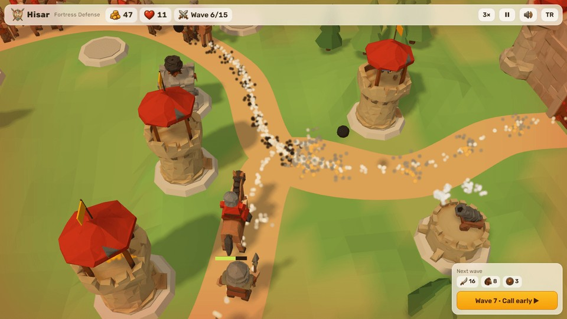
  </a>
</p>

<p align="center">
  <a href="https://furkiozknn.github.io/kale-savunmasi/"></a>
</p>

<p align="center">
  
  
  <a href="LICENSE"></a>
  
</p>

<!-- portals:start -->
<p align="center">
  Also on: <a href="https://furkiozknn.itch.io/kale-savunmasi"><strong>itch.io</strong></a>
</p>
<!-- portals:end -->

<p align="center">
  <strong>A low-poly 3D tower defense game in a seaside valley: an army marches on the fortress along two roads; build archers, cannons and tar cauldrons on the stone pads, upgrade them and hold the walls for 15 waves.</strong>
</p>

<!-- gameplay gif -->

## Features

- **Three towers, three tactical upgrades:** Build Archer Towers (60 gold) for rapid single targets, Cannon Bastions (110 gold) for ballistic splash damage, and Tar Cauldrons (80 gold) to slow and ignite enemies; each upgrades twice, features 3 targeting modes (First, Strongest, Nearest), and returns a 70% refund on sell.
- **Four enemy classes & boss sieges:** Defend against raiders, galloping riders (wave 3+), and arrow-shrugging shieldbearers (wave 5+), bracing for battering ram bosses on waves 5, 10, and 15 that consume 6 of your 20 lives if they breach the gate.
- **15 waves to victory, then endless:** Command defenses across two marching roads with 180 starting gold, collect early-call wave bonuses, toggle 1x / 2x / 3x speed, and push into escalating endless mode with automatic progress saves after every cleared wave.
- **Fair AI tested by bot:** An automated simulation bot (`?auto`) plays independently at 3x speed—building, upgrading, and calling waves—surviving through wave 15 with 13 towers and 0 JS errors.
- **Ultra-lean web performance:** A single `index.html` running Three.js r170 delivering 60 fps at 46–60 draw calls on Intel UHD 620 (195–214k triangles; 52 calls on `?low`), backed by procedural 3D fallbacks and zero runtime dependencies.

## How to play

> [!TIP]
> **Goal:** Hold the fortress for 15 waves. You start with 20 lives; enemies reaching the gate deplete them, and at zero the fortress falls. Clear wave 15 to secure victory, then continue into endless mode.

1. **Build your line:** You start with 180 gold. Click any stone pad along the two roads (or press `1`, `2`, `3`) to construct an Archer Tower (60 gold), Cannon Bastion (110 gold), or Tar Cauldron (80 gold).
2. **Release the wave (`Space`):** Trigger the wave button to start the march. Calling the next wave early while enemies remain on the road awards bonus gold.
3. **Upgrade and adapt:** Click an existing tower to upgrade (`U`), sell for a 70% refund (`S`), or cycle targeting priorities (`T`: First, Strongest, Nearest) to counter incoming enemy combinations.

<details>
<summary><b>Moves and rules</b></summary>

- **Tower costs & upgrades:** Archer Tower (60 gold), Cannon Bastion (110 gold), and Tar Cauldron (80 gold). Each tower can be upgraded twice. Selling refunds 70% of total gold invested.
- **Scoring & gold:** Defeating enemies awards gold, and each cleared wave grants a bonus. Calling waves early while attackers remain on the road awards an extra early-call bonus.
- **Gate penalties:** Raiders and Riders cost 1 life, Shieldbearers cost 2 lives, and Battering Ram bosses cost 6 lives. Enemy health scales with each passing wave.
- **Armour & resistances:** Armour negates arrow damage completely and halves cannonball impact damage; burning tar ignores armour entirely. Tar slows enemies directly, and spilled puddles slow any units crossing them.
- **Enemy progression:** Riders appear starting at wave 3, Shieldbearers join at wave 5, and Battering Ram bosses attack on waves 5, 10, and 15.
- **Persistence:** Your highest wave is saved in `localStorage`, and personal bests are highlighted on the completion screen.

</details>

### Controls

| Action | Mouse / touch | Keyboard |
|---|---|---|
| Select a pad or a tower | click / tap | |
| Build on the selected pad | build panel | `1` `2` `3` |
| Upgrade / sell / target mode | tower panel | `U` / `S` / `T` |
| Start or call the next wave | wave button | `Space` |
| Pan | drag / one finger | |
| Rotate | right-drag / two fingers | |
| Zoom | wheel / pinch | |
| Speed 1x / 2x / 3x | speed button | `F` |
| Pause menu | pause button | `P` / `Esc` (Esc first closes the panel) |
| Music / effects / language | settings | `M` / `X` / `L` |
| Fullscreen | settings | |

- **Global hotkeys:** `P` / `Esc` pause (Esc first closes any active panel), `M` music, `X` sound effects, `L` language toggle.
- **Audio control:** Sound effects and music toggles are accessible from the top-right settings panel and remembered across sessions.
- **Touch:** Drag to pan, two-finger drag to rotate, pinch to zoom, and tap any stone pad or tower for responsive touch gameplay.
- **Speed control:** Toggle between 1x, 2x, and 3x game simulation speeds with `F` or the HUD speed button.
- **Persistence:** Settings (master, music, and effects volume, TR / EN, Low / High quality, fullscreen) are saved in `localStorage` under `arena.hisar.settings`; current run under `arena.hisar.save`; best wave under `arena.hisar.best`. Initial visit follows browser language; touch devices default to Low quality.

<details>
<summary><b>URL flags for testing</b></summary>

| Flag | Effect |
|---|---|
| `?auto` | The game plays itself at 3x speed (builds, upgrades, calls waves) and writes nothing to `localStorage` |
| `?debug` | Draw calls, triangles, FPS, and error count on screen; `window.hisarSim(seconds)` fast-forwards, `window.hisarSelect(padIndex)` selects a pad |
| `?sim=N` | With `?auto`: fast-forward N seconds before the first frame |
| `?low` | No shadows, pixel ratio 1, fewer trees and rocks, half the particles |
| `?lang=en` / `?lang=tr` | Language selection |
| `?cam=x,y,z,tx,tz` | Camera position and target (stops title orbit; used for screenshots) |
| `?noassets` | Skip generated low-poly models and fall back to procedural geometry |

`window.hisar` exposes the live state (`gold`, `lives`, `wave`, `towers`, `enemies`, `errors`).

</details>

## Screenshots

<table>
  <tr>
    <td width="33%">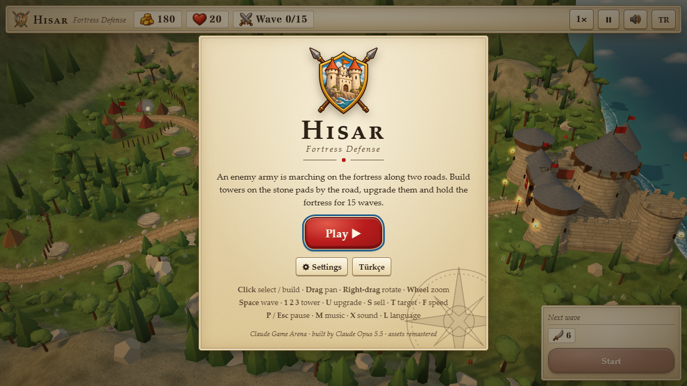<br><sub>Title screen</sub></td>
    <td width="33%">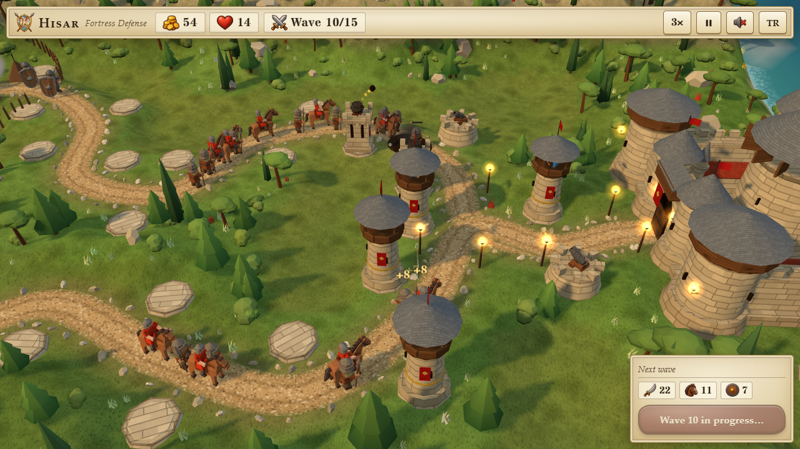<br><sub>Wave 10 on both roads</sub></td>
    <td width="33%">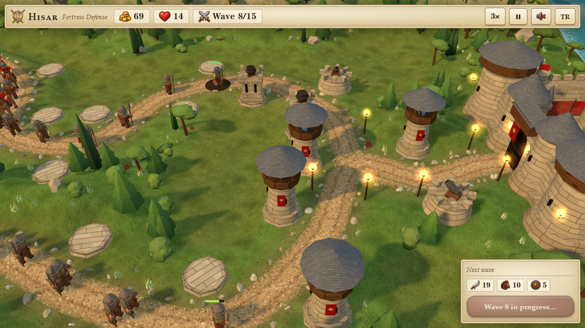<br><sub>Towers and enemies up close</sub></td>
  </tr>
  <tr>
    <td>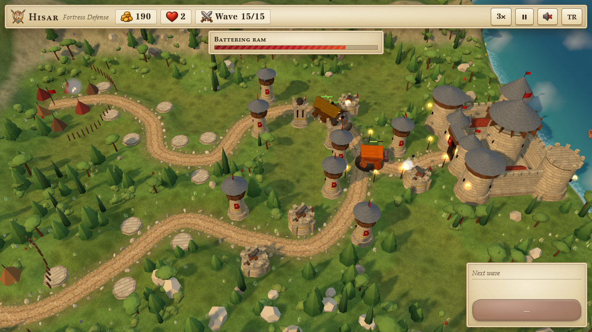<br><sub>Battering ram and its boss bar</sub></td>
    <td>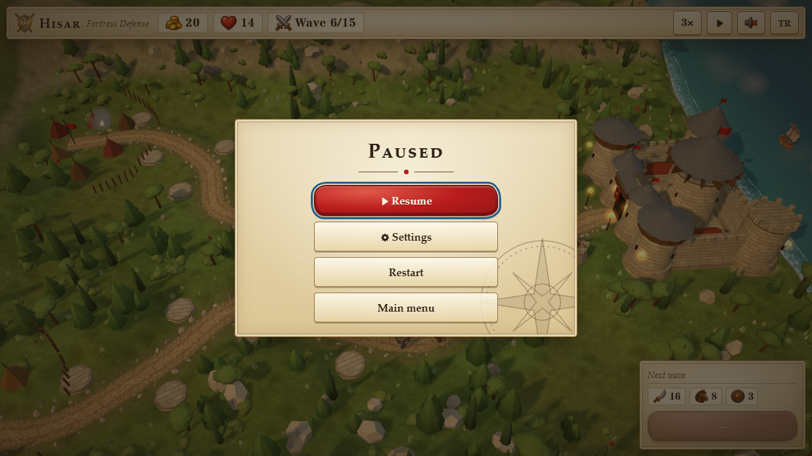<br><sub>Pause menu</sub></td>
    <td>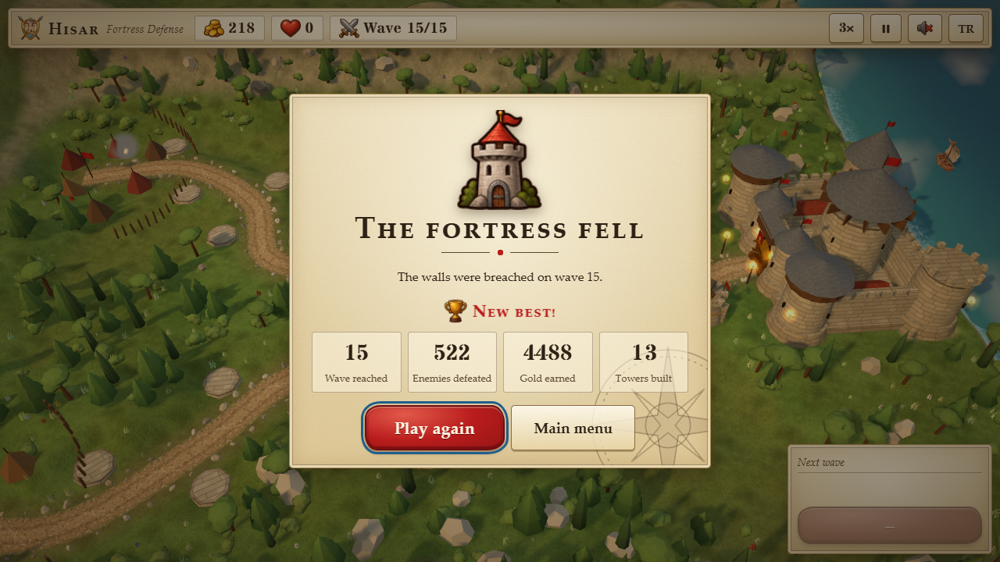<br><sub>End screen with a new best</sub></td>
  </tr>
</table>

<details>
<summary><b>Phone layout, settings and more views</b></summary>

<table>
  <tr>
    <td width="50%">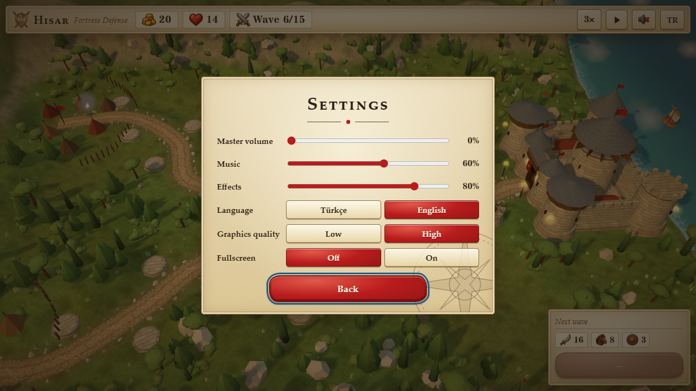<br><sub>Settings</sub></td>
    <td width="50%">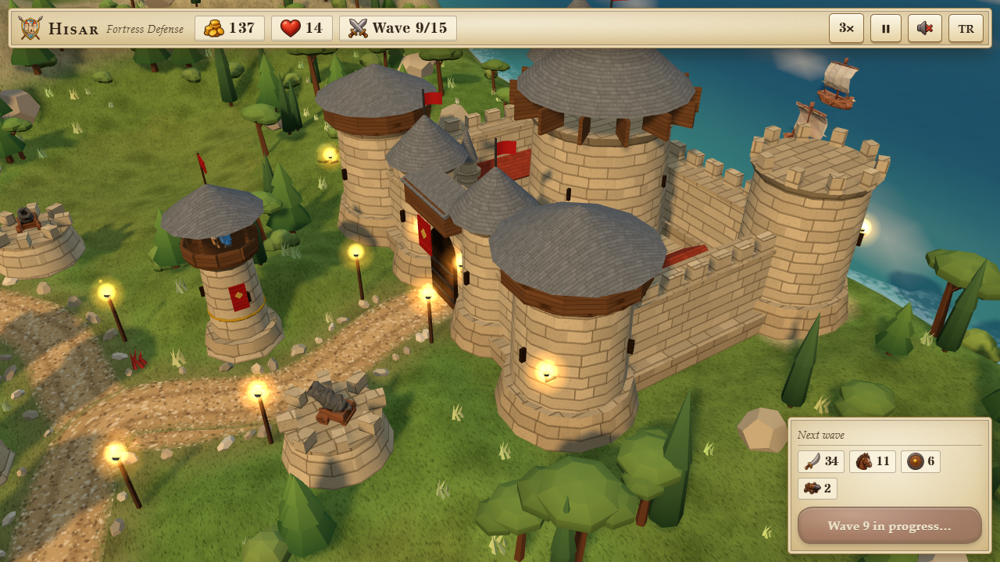<br><sub>The gate: hoardings, torches and the keep</sub></td>
  </tr>
  <tr>
    <td>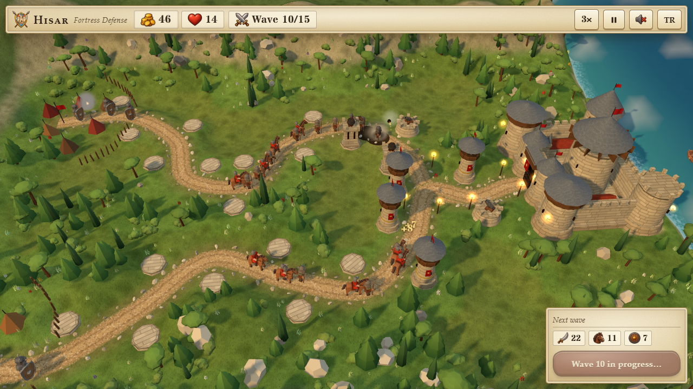<br><sub>Battle overview</sub></td>
    <td><br><sub>Wave 15: two rams and the boss bar</sub></td>
  </tr>
</table>

<p align="center">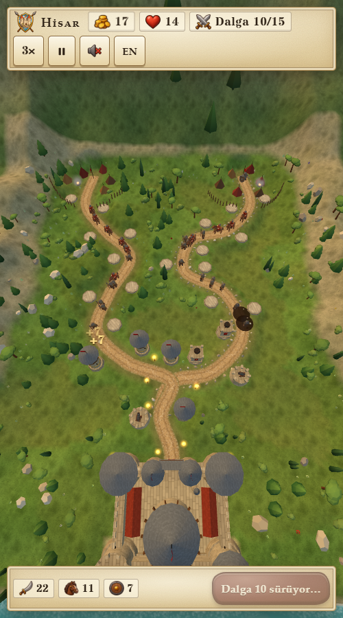<br><sub>On a phone: the portrait camera looks along the roads to the gate</sub></p>

</details>

## Redesign & Performance

**Art direction:** Stylized 3D strategy defense on the Bosphorus in late-afternoon light. Palette: limestone `#CFC3A6`, slate `#4B5563`, Bosphorus blue `#1F5F8B`, banner red `#B91C1C`, torch `#F59E0B`.

**Visual updates (rules, controls, bot, and saves are untouched):**
- **Light & world:** Low warm sun with long shadows and cool rim light from the sea; terrain extends past the battlefield to wooded hills and the Asian shore (waterfront houses, a mosque with two minarets) with atmospheric haze. Detail meadow textures, worn verges, packed-earth roads with kerb stones, flagstone pads, stone pines, cypresses, and palisaded camps with banners.
- **Fortress & towers:** Rebuilt in code from drawn limestone-ashlar textures with battered curtain walls, merlons, round towers with slate cones, timber hoardings, a gatehouse with plank doors, keep, barracks, and minaret. Archer towers, cannon bastions, and tar cauldrons gain hoardings, banners, brass bands, and pennants by level.
- **Animation & FX:** Marching step, lean, and sway for infantry; rocking gallop for riders; arrow trails; muzzle flashes and drifting cannon smoke; dust and fire impact craters; burning tar pools; flickering torches with embers; rippling banners; whitecaps and surf on the water.
- **UI:** A war table: parchment panels with ruled ink borders, red wax-seal buttons, self-hosted Stardos Stencil numerals, Palatino small caps, and a compass-rose watermark (zero remote Google Fonts requests).

**Measured on an Intel UHD 620 (headless Chrome, 1280x720, `?auto&debug&sim=600`):**
- Draw calls: 46–52 (before: 43; 60 at the end of wave 15)
- Triangles: 195–214k (before: 90–101k)
- Frame rate: Solid 60 fps
- Low-tier mode (`?low`): 52 draw calls, 162k triangles, 60 fps
- Simulation bot: Holds until wave 15 with 13 towers and 0 JS errors (both with assets and with `?noassets`)

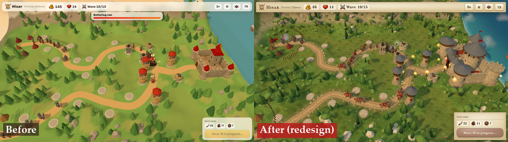

## Running locally

Serve the folder over HTTP (ES modules and 3D models do not load from `file://`):

```bash
python -m http.server 8000
```

Then open <http://localhost:8000/>.

## Made with Claude Code

Built by **Claude Opus 5.5** with Claude Code from one prompt: [prompts/hisar.md](prompts/hisar.md). The initial version was fully procedural—scenery, fortress, camps, towers, and enemies with vertex colours, and Web Audio API synthesized sound effects with a 9/8 Hicaz musical loop.

### Remaster & Redesign

Upgraded by **Claude Opus 5.5** with Claude Code across two iterations: an asset remaster introducing low-poly models and painted icons, followed by the 2026-11 architectural redesign with textured procedural masonry and war-table cartographic UI.

- **Hybrid asset pipeline:** Eight low-poly models (~900–1,500 triangles each; ~1.1 MB in `assets/`) generated via Tripo and optimized with glTF-Transform, with procedural mesh fallbacks retained for offline resilience.
- **Fair balance tested by bot:** Tower parameters (`TOWERS`) and enemy scalings (`ENEMIES`, `hpMul()`) were tuned using automated bots; the bot holds until wave 15 with 13 towers and 0 JS errors before and after remastering.
- **Self-hosted typography & zero external bloat:** War table UI styling uses self-hosted Stardos Stencil numerals and standard serif typography with zero runtime CDN font dependencies. Prompts, asset dimensions, and before/after metrics: [docs/assets.md](docs/assets.md). (A Godot 4 remake was created in round 2).

<details>
<summary><b>Technical notes</b></summary>

- **Simulation & balance:** Pure JavaScript simulation loop driving wave generation (`makeWave`), waypoint pathfinding along dual road splines, ballistic arc trajectories, splash damage radii, and sticky tar patches.
- **Rendering:** Three.js r170 via CDN; low warm directional sunlight with a 1024 shadow map; custom procedural ashlar limestone shader-canvas textures; instanced road stones, trees, and palisades; soft-particle smoke, embers, and water surf.
- **Audio (Web Audio API):** Procedural synthesis for cannon reports, arrow thuds, burning cauldrons, marching footsteps, and a dynamic 9/8 Hicaz modal theme whose drums activate during waves.
- **Fallbacks & offline resilience:** Full procedural geometry generator activates if model files fail to load or when using `?noassets`.

</details>

### Claude Game Arena

Hisar is part of the **Claude Game Arena** series, where each game is built by a Claude model from one prompt.

[Çay Ocağı](https://furkiozknn.github.io/cay-ocagi/) · [Çini Ustası](https://furkiozknn.github.io/cini-ustasi/) · [Martı](https://furkiozknn.github.io/marti/) · [Kervan](https://furkiozknn.github.io/kervan/) · [Dolmuş](https://furkiozknn.github.io/dolmus/) · [Peri Golf](https://furkiozknn.github.io/peri-golf/) · [Mehter](https://furkiozknn.github.io/mehter/) · [Boğaz Vapuru](https://furkiozknn.github.io/bogaz-vapuru/) · [Simit Fırını](https://furkiozknn.github.io/simit-firini/) · [Karagöz](https://furkiozknn.github.io/karagoz/) · [Lale Bahçesi](https://furkiozknn.github.io/lale-bahcesi/)

**Round 5:** [Kapadokya Balonu](https://furkiozknn.github.io/kapadokya-balonu/) · [Ebru](https://furkiozknn.github.io/ebru/) · [Kırkpınar](https://furkiozknn.github.io/kirkpinar/) · [Çarşı Kaçışı](https://furkiozknn.github.io/carsi-kacisi/)

**Round 6:** [Topkapı Gecesi](https://furkiozknn.github.io/topkapi-gecesi/) · [Hamsi](https://furkiozknn.github.io/hamsi/) · [Pamukkale](https://furkiozknn.github.io/pamukkale/) · [Mimar Sinan](https://furkiozknn.github.io/mimar-sinan/)

## License

MIT, see [LICENSE](LICENSE).

Like the game? You can support new rounds on [Buy Me a Coffee](https://buymeacoffee.com/furkiozkann). The game stays free.
