<p align="center">
  <a href="https://furkiozknn.github.io/kale-savunmasi/"></a>
</p>

<p align="center">
  <a href="https://furkiozknn.github.io/kale-savunmasi/"></a>
  
  
  <a href="LICENSE"></a>
  
</p>

<p align="center"><b>A low-poly 3D tower defense game in a seaside valley: an army marches on the fortress along two roads; build archers, cannons and tar cauldrons on the stone pads, upgrade them and hold the walls for 15 waves.</b></p>

<p align="center">
  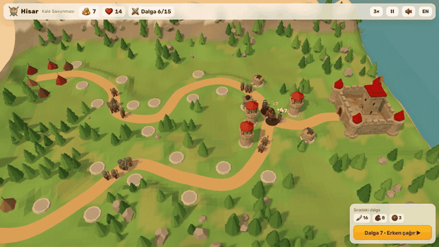
</p>

<p align="center"><b>Play online: <a href="https://furkiozknn.github.io/kale-savunmasi/">https://furkiozknn.github.io/kale-savunmasi/</a></b> (desktop and phone, no install)</p>

<!-- portals:start -->
<p align="center">Also on: <a href="https://furkiozknn.itch.io/kale-savunmasi">itch.io</a></p>
<!-- portals:end -->

## Highlights

- **Three towers, three levels each.** The Archer Tower fires fast single-target arrows, the Cannon Bastion lobs
  ballistic shots at a predicted landing point with splash damage, and the Tar Cauldron slows, burns over time and
  leaves sticky tar on the road.
- **Four enemy types.** Raiders, fast Riders, armoured Shieldbearers that shrug off arrows, and a Battering Ram boss
  every 5th wave that costs 6 lives if it reaches the gate.
- **Tactics in every wave.** Three target modes per tower (First, Strongest, Nearest), sell for a 70 % refund, call
  the next wave early for bonus gold, and play at 1x, 2x or 3x speed.
- **15 waves, then endless.** The run is saved after every cleared wave, so **Continue** picks it up after a reload;
  after the victory the waves keep getting stronger in endless mode.
- **Tested by a bot.** The `?auto` bot builds, upgrades and calls waves on its own; in the measured run it held out
  until wave 15 and fell there, so a full win asks for better play than the bot's.
- **Light on a laptop GPU.** 60 fps on an Intel UHD GPU at 1280x720 with 37-42 draw calls in battle, and a `?low` tier
  for weak GPUs ([measurements](docs/assets.md)).
- **One file plus generated models.** One `index.html` with Three.js r170 from a CDN, twelve generated low-poly models
  and a painted icon set; every model keeps a procedural version as the fallback.

## How to play

> [!TIP]
> **Goal:** hold the fortress for 15 waves. It has 20 lives; every enemy that reaches the gate costs some of them, and
> at zero the fortress falls. After a victory you can continue in endless mode.

You start with 180 gold. Click a stone pad by the road to open the build panel and pick a tower, then press the wave
button (or `Space`) to send the first wave. The box in the corner shows which enemies the next wave brings. Click a
tower to upgrade it, sell it or change its target mode.

<details>
<summary><b>More rules</b></summary>

- Building costs 60 gold for an Archer Tower, 110 for a Cannon Bastion and 80 for a Tar Cauldron; each tower can be
  upgraded twice. Selling refunds 70 % of everything spent on that tower.
- Kills pay gold, and every cleared wave pays a bonus. Calling the next wave while enemies are still on the road adds
  an early-call bonus.
- Raiders and Riders cost 1 life at the gate, Shieldbearers 2 and the Battering Ram 6. Enemy health grows with every
  wave.
- Armour cuts arrow damage in full and cannonball damage by half; burning tar ignores it. Tar slows its targets, and
  the puddles it leaves slow whoever walks through them.
- Riders appear from wave 3, Shieldbearers from wave 5, and a Battering Ram comes on waves 5, 10 and 15.
- Your best wave is kept, and a new best is highlighted on the end screen.

</details>

### Controls

| Action | Mouse / touch | Keyboard |
|---|---|---|
| Select a pad or a tower | click / tap | |
| Build on the selected pad | build panel | `1` `2` `3` |
| Upgrade / sell / target mode | tower panel | `U` / `S` / `T` |
| Start or call the next wave | wave button | `Space` |
| Pan | drag / one finger | |
| Rotate | right-drag / two fingers | |
| Zoom | wheel / pinch | |
| Speed 1x / 2x / 3x | speed button | `F` |
| Pause menu | pause button | `P` / `Esc` (Esc first closes the panel) |
| Music / effects / language | settings | `M` / `X` / `L` |
| Fullscreen | settings | |

Settings (master, music and effects volume, TR / EN, Low / High quality, fullscreen) are saved in `localStorage` under
`arena.hisar.settings`; the run under `arena.hisar.save`, the best wave under `arena.hisar.best`. The first visit follows
the browser language; touch devices start on Low quality.

<details>
<summary><b>URL flags for testing</b></summary>

| Flag | Effect |
|---|---|
| `?auto` | the game plays itself at 3x speed (builds, upgrades, calls waves) and writes nothing to `localStorage` |
| `?debug` | draw calls, triangles, fps and the error count on screen; `window.hisarSim(seconds)` fast-forwards, `window.hisarSelect(padIndex)` selects a pad |
| `?sim=N` | with `?auto`: fast-forward N seconds before the first frame |
| `?low` | no shadows, pixel ratio 1, fewer trees and rocks, half the particles |
| `?lang=en` / `?lang=tr` | language |
| `?cam=x,y,z,tx,tz` | camera position and target (stops the title orbit; used for screenshots) |
| `?noassets` | skip the generated models and use the procedural ones |

The live state is on `window.hisar` (gold, lives, wave, towers, enemies, errors).

</details>

## Screenshots

<table>
  <tr>
    <td width="33%">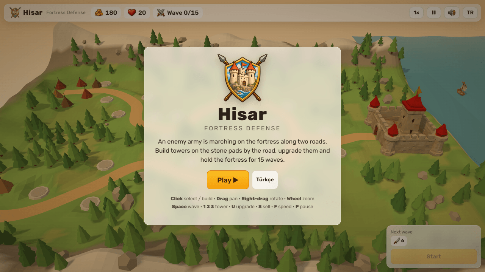<br><sub>Title screen</sub></td>
    <td width="33%">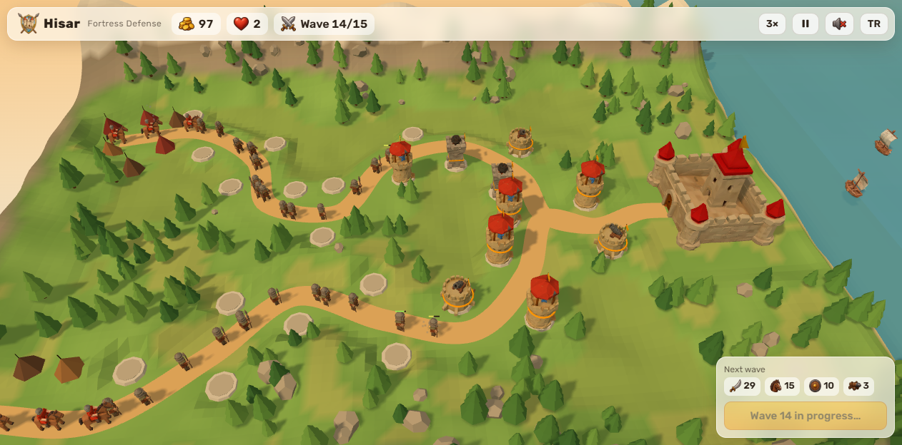<br><sub>Wave 14 on both roads</sub></td>
    <td width="33%">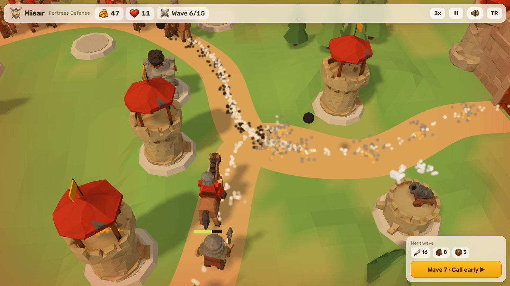<br><sub>Towers and enemies up close</sub></td>
  </tr>
  <tr>
    <td>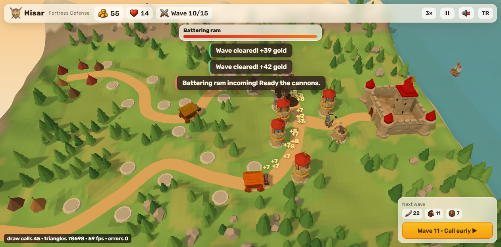<br><sub>Battering ram and its boss bar</sub></td>
    <td>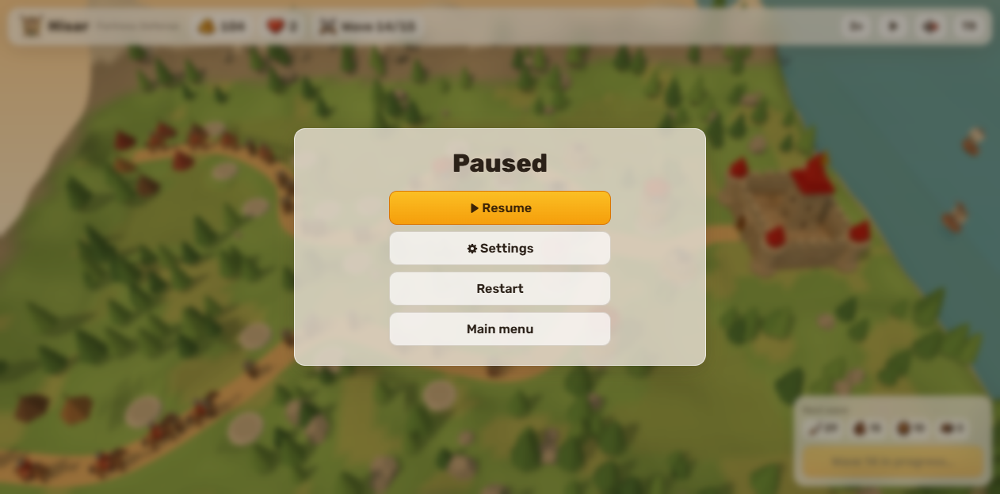<br><sub>Pause menu</sub></td>
    <td>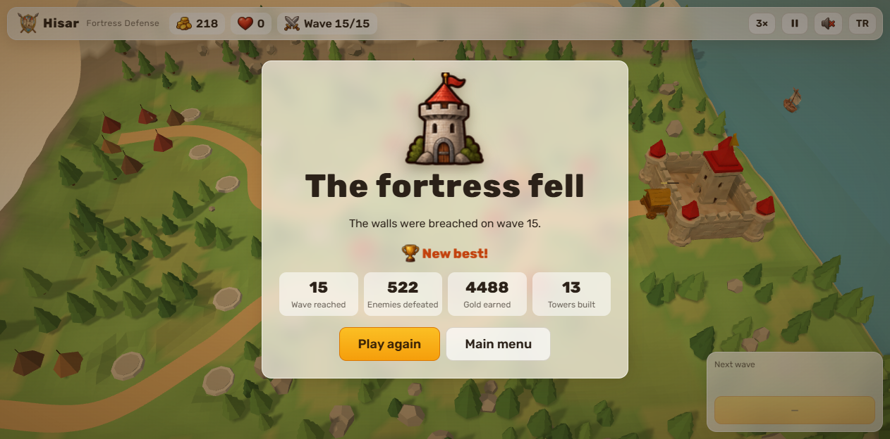<br><sub>End screen with a new best</sub></td>
  </tr>
</table>

<details>
<summary><b>Phone layout, settings and the procedural look before the remaster</b></summary>

<table>
  <tr>
    <td width="50%">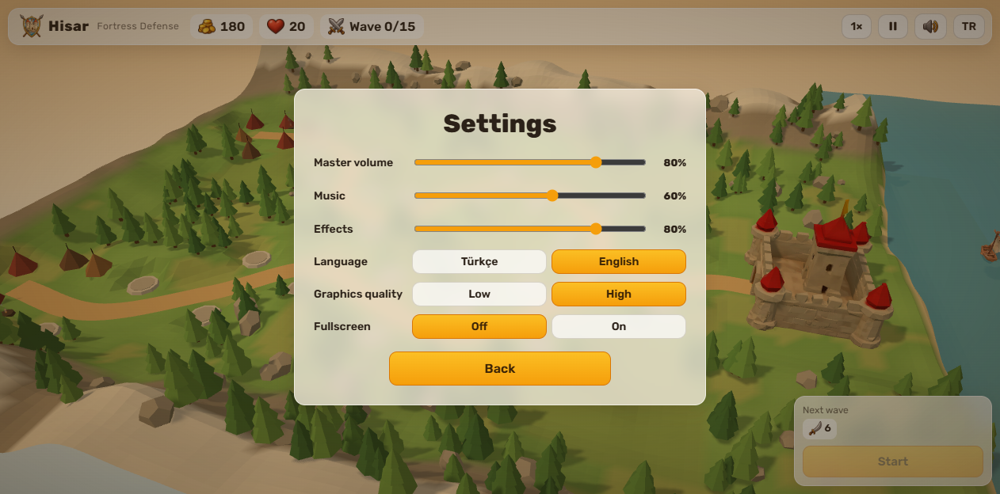<br><sub>Settings</sub></td>
    <td width="50%">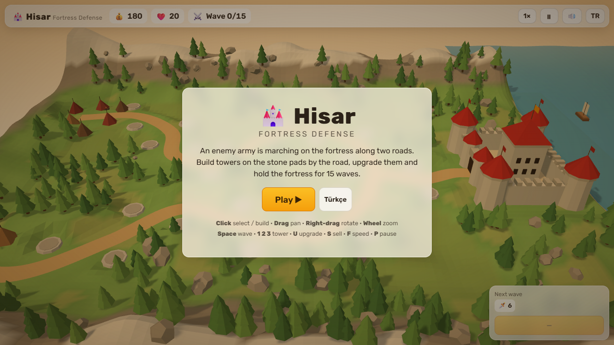<br><sub>Title screen, procedural</sub></td>
  </tr>
  <tr>
    <td>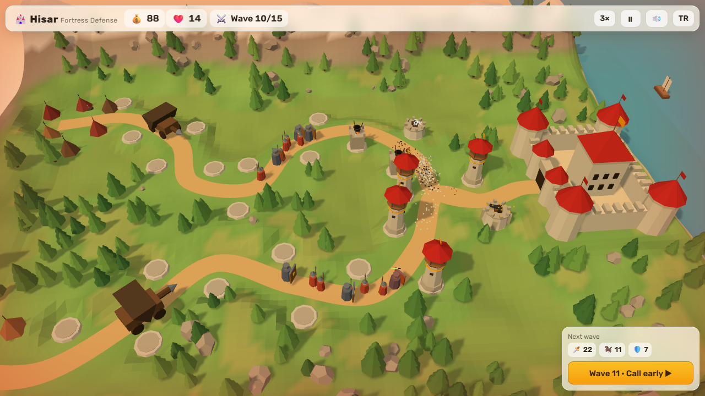<br><sub>Battle overview, procedural</sub></td>
    <td>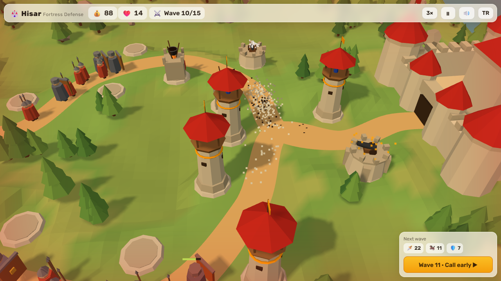<br><sub>Road junction, procedural</sub></td>
  </tr>
</table>

<p align="center">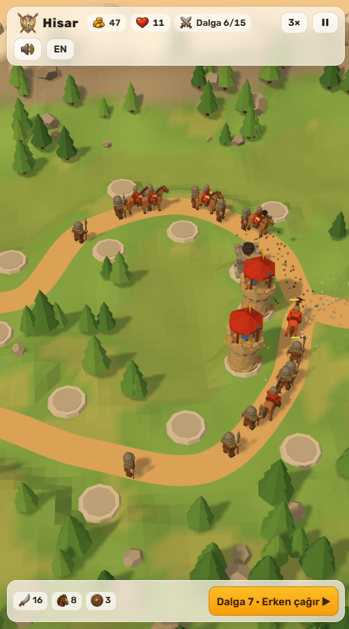<br><sub>On a phone: the portrait camera looks along the roads</sub></p>

</details>

## Balance

Towers and enemies are two data tables at the top of the script (`TOWERS`, `ENEMIES`), and each wave is built by
`makeWave()` with enemy health scaled by `hpMul()`. The self-test bot was used to tune them: the first version was too
easy (the bot lost only 2 lives), so enemy health growth and the ram were made tougher. In the measured
`?auto&debug&sim=2000` run the bot falls on wave 15 with 13 towers, the same result before and after the asset remaster,
with 0 JS errors.

## Running locally

Serve the folder over HTTP (opened from `file://`, the browser blocks the model files and the game uses its procedural
models):

```
python -m http.server 8000
```

then open <http://localhost:8000/>.

## How it was made

Built by **Claude Opus 5.5** with Claude Code from one prompt: [prompts/hisar.md](prompts/hisar.md). The first version
was fully procedural: the valley, the fortress, the camps, the towers and the enemies are merged or instanced low-poly
primitives with vertex colours, and every sound effect is synthesised with the Web Audio API. The music, a 9/8 loop in
the Hicaz mode whose drums come in during waves, was added later in Web Audio as well.

The assets were remastered by the orchestrator, **Claude Opus 5.5**, with generated models: Tripo text-to-3D (through
Higgsfield) for the fortress, the four enemies, the three tower bases, their turrets and the boats, and GPT Image for a
16-icon sheet and the logo crest. The models were processed with glTF-Transform (about 900-1,500 triangles each, 5,540
for the fortress, about 1.1 MB in `assets/`), and every procedural model stays as the fallback. Prompts, sizes, the
rejected asset and fps before and after: [docs/assets.md](docs/assets.md). A Godot 4 remake was made in round 2.

Hisar is part of the **Claude Game Arena** series, where each game is built by a Claude model from one prompt. The other
games: [Çay Ocağı](https://furkiozknn.github.io/cay-ocagi/) · [Çini Ustası](https://furkiozknn.github.io/cini-ustasi/) ·
[Martı](https://furkiozknn.github.io/marti/) · [Kervan](https://furkiozknn.github.io/kervan/) ·
[Dolmuş](https://furkiozknn.github.io/dolmus/) · [Peri Golf](https://furkiozknn.github.io/peri-golf/) ·
[Mehter](https://furkiozknn.github.io/mehter/) · [Boğaz Vapuru](https://furkiozknn.github.io/bogaz-vapuru/) ·
[Simit Fırını](https://furkiozknn.github.io/simit-firini/) · [Karagöz](https://furkiozknn.github.io/karagoz/) ·
[Lale Bahçesi](https://furkiozknn.github.io/lale-bahcesi/)

**Round 5:** [Kapadokya Balonu](https://furkiozknn.github.io/kapadokya-balonu/) ·
[Ebru](https://furkiozknn.github.io/ebru/) · [Kırkpınar](https://furkiozknn.github.io/kirkpinar/) ·
[Çarşı Kaçışı](https://furkiozknn.github.io/carsi-kacisi/)

**Round 6:** [Topkapı Gecesi](https://furkiozknn.github.io/topkapi-gecesi/) ·
[Hamsi](https://furkiozknn.github.io/hamsi/) · [Pamukkale](https://furkiozknn.github.io/pamukkale/) ·
[Mimar Sinan](https://furkiozknn.github.io/mimar-sinan/)

## Türkçe

**Hisar**, sahildeki bir kaleyi iki yoldan yürüyen bir orduya karşı savunduğun alçak poligon 3D kule savunma oyunu. Yol
kenarındaki taş kaidelere okçu kulesi, top tabyası ve katran kazanı kur, kuleleri geliştir ve 15 dalga boyunca hisarı
ayakta tut; her beşinci dalgada bir koçbaşı gelir. Zaferden sonra sonsuz modda ne kadar dayanacağını gör. Kurulum yok;
masaüstünde ve telefonda tarayıcıda oynanır. Claude Opus 5.5 tarafından Claude Code ile tek bir prompt'tan yapıldı.

**Oyna:** https://furkiozknn.github.io/kale-savunmasi/

## License

MIT, see [LICENSE](LICENSE).

Like the game? You can support new rounds on [Buy Me a Coffee](https://buymeacoffee.com/furkiozkann). The game stays free.
