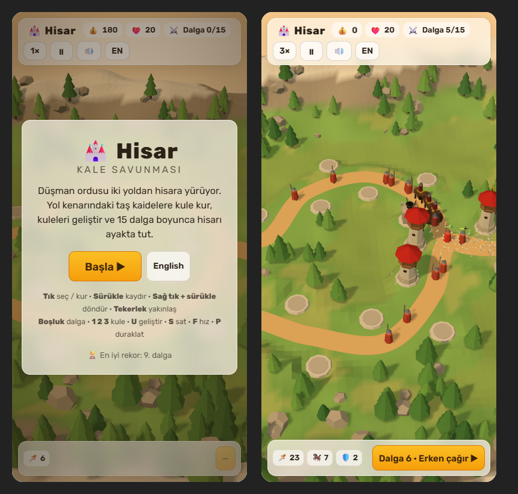

# 🏰 Hisar · Fortress Defense

**[▶ Play in your browser](https://furkiozknn.github.io/kale-savunmasi/)** · English & Türkçe · desktop & mobile · free, no install

A low-poly 3D tower defense game in a **single `index.html`** (Three.js, no build step, no asset files).
An army marches on a seaside fortress along two roads. Build towers on the stone pads, upgrade them,
and hold the walls for 15 waves. Then see how long you last in endless mode.

## Features

- **3 towers × 3 levels:** 🏹 Archer Tower (fast single-target arrows), 💣 Cannon Bastion (ballistic shots with a predicted
  landing point and splash damage), 🔥 Tar Cauldron (slows, burns over time, leaves sticky tar on the road).
- **4 enemy types:** Raiders, fast Riders, armoured Shieldbearers (arrows do less damage) and a Battering Ram boss every
  5th wave that costs 6 lives if it reaches the gate.
- **Tactics:** three target modes per tower (First, Strongest, Nearest), sell for a 70% refund, call the next wave early
  for bonus gold, 1× / 2× / 3× speed.
- **15 waves + endless mode**, best wave saved in your browser.
- **Everything is generated in code:** terrain, fortress, enemies, towers, particles and every sound effect (Web Audio).
- **Runs on a laptop iGPU:** instanced meshes, merged geometry, one 1024 shadow map, about 35 draw calls in a full battle. Use `?low` if it stutters.
- **Turkish by default, English with one click.** Touch controls on phones and tablets.

| | |
|---|---|
|  |  |
|  | |

## Controls

| Action | Mouse / keyboard | Touch |
|---|---|---|
| Build / select | Click a pad or a tower | Tap |
| Pan | Drag | One finger |
| Rotate | Right-drag | Two fingers |
| Zoom | Mouse wheel | Pinch |
| Next wave | `Space` | Wave button |
| Build tower 1 / 2 / 3 | `1` `2` `3` (with a pad selected) | Panel |
| Upgrade / sell | `U` / `S` | Panel |
| Speed / pause / close | `F` / `P` / `Esc` | Top bar |

## Run it locally

Download the repo and double-click `index.html`. It needs internet the first time, to load Three.js and the font from a CDN.
Or serve the folder: `python -m http.server 8766`, then open http://127.0.0.1:8766/.

### URL flags

| Flag | Effect |
|---|---|
| `?low` | No shadows, half the particles and trees, for weak GPUs |
| `?lang=en` / `?lang=tr` | Interface language |
| `?auto` | The game plays itself at 3× speed (self-test bot) |
| `?auto&sim=600` | Fast-forwards 600 seconds of play before the first frame |
| `?cam=x,y,z,tx,tz` | Sets the camera position and target (for screenshots) |
| `?debug` | Shows draw calls on screen, logs them every 5 s and exposes `hisarSim(seconds)` to fast-forward the simulation |

## How it was made

Built with [Claude Code](https://claude.com/claude-code) by **Claude Opus 5.5** from one prompt: [`prompts/hisar.md`](prompts/hisar.md).
The prompt follows a six-block template (World, Life, Interaction, Dashboard, Extras, Performance) and adds two
blocks of its own: **Game rules** and **Self-test**. The self-test bot played the full 15 waves in a real browser to
check for errors and to tune the difficulty: the first version was too easy (the bot lost only 2 lives),
so enemy HP growth and the ram were made tougher.

This is game #1 of a series in which **every game is built by a different AI model**, to compare which one makes the
better game. Later, the best of them will be rebuilt in Godot 4.

| # | Game | Genre | Model |
|---|---|---|---|
| 1 | **Hisar** | Tower defense, 3D | Claude Opus 5.5 |

## Tech

Three.js r170 (ES module from jsDelivr), OrbitControls, BufferGeometryUtils, Web Audio API, one Google Font (Rubik).
About 1,400 lines of plain JavaScript, HTML and CSS in one file.

## License

Code: [MIT](LICENSE).
